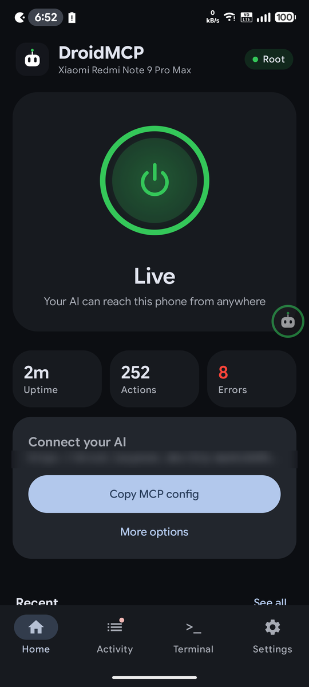
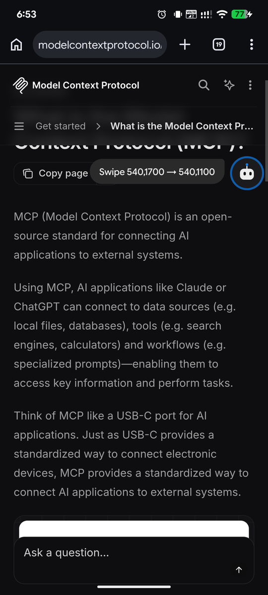
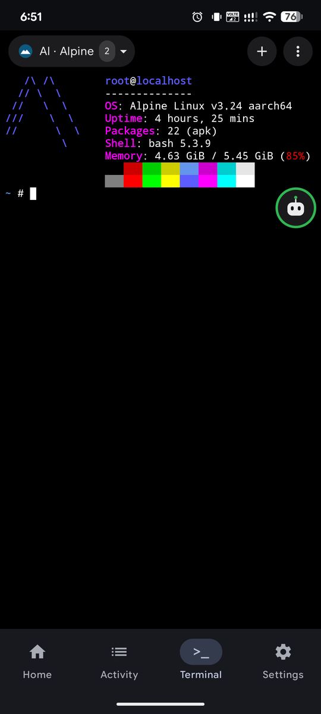
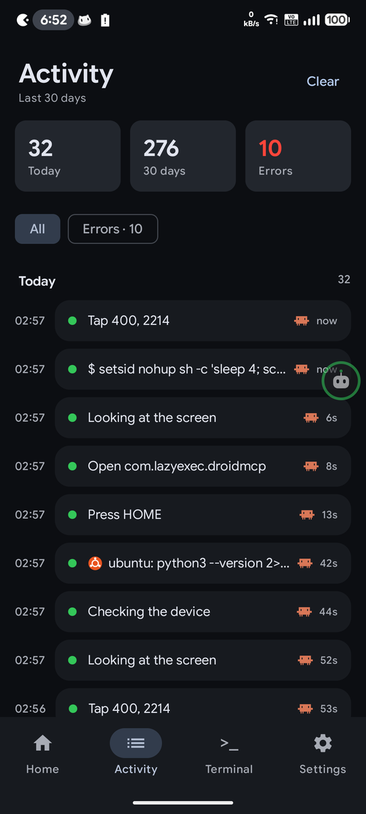
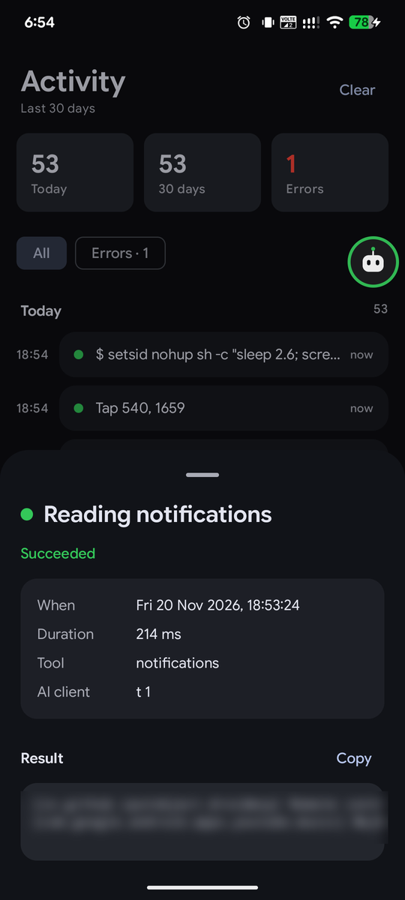
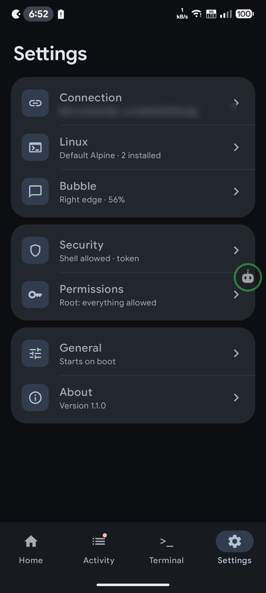

<p align="center">
  
</p>

<h1 align="center">DroidMCP</h1>

<p align="center">
  Let an AI agent use your Android phone, from anywhere.<br>
  An <a href="https://modelcontextprotocol.io">MCP</a> server that runs on the phone, with a public URL, a full Linux, and a live terminal you can share with the AI.
</p>

<p align="center">
  
  
  
</p>
<p align="center">
  
  
  
</p>

---

## What it does

Connect Claude Code, Claude Desktop, Cursor or any other MCP client, and the AI can:

- **See and use the screen:** take screenshots, read the on-screen elements, tap, swipe, type and press keys.
- **Use the phone:** open apps and links, read notifications, read and send SMS, and read and write files.
- **Work in Linux:** Alpine or Ubuntu run inside the app, so the AI can use `apk`/`apt`, git, Python, Node and more. No root or Termux is needed.
- **Share a terminal with you:** the AI's commands run in a visible session you can watch, type into, answer prompts in, or stop.

You always see what it's doing: a chat-bubble overlay shows each action live, and the **Activity** tab keeps 30 days of history with full details.

```
MCP client ──HTTPS──▶ relay ◀──WebSocket── DroidMCP (your phone)
                      /d/<device-id>/mcp
```

The phone connects *out* to the relay, so it works on mobile data and behind any router, with no port forwarding.

## Quick start

1. **Install** the APK from [Releases](../../releases).
   From this version the package is `com.lazyexec.droidmcp`, so it installs as a new app next to
   the old `io.github.iputobject.droidmcp`. Uninstall the old app; settings and pairing must be
   set up again.
2. **Open DroidMCP** and tap the power button. It connects to the free public relay at
   `droid.lazyexec.dev` with a random device ID, so no account or server is needed.
   - With root, everything works right away.
   - Without root, follow the setup checklist on Home (accessibility, notifications and so on).
3. **Connect your AI:** tap **Copy MCP config** and paste it into your client. For Claude Code:

   ```bash
   claude mcp add --transport http android https://<relay>/d/<device-id>/mcp \
     --header "Authorization: Bearer <token>"
   ```

## Tools

| Tool | What it does |
|---|---|
| `screenshot`, `ui_tree` | See the screen: an image, or every element with tap coordinates |
| `tap`, `long_press`, `swipe`, `type_text`, `key` | Touch and keyboard input |
| `launch_app`, `list_apps`, `open_url` | Apps, intents and deep links |
| `notifications`, `sms_list`, `send_sms` | Notifications and messages |
| `read_file`, `write_file` | Files (any path with root, shared storage without) |
| `linux_exec`, `linux_setup` | Run commands in Alpine or Ubuntu (`distro`), in the shared AI terminal by default |
| `terminal_read`, `terminal_input` | Read a terminal screen; type into it (answer prompts, Ctrl+C) |
| `shell` | The phone's own shell (root when available) |
| `device_info` | Model, Android version, battery, screen, network, root status |

## Root or no root

| | With root | Without root |
|---|---|---|
| Screen, input, keys | `screencap`, `input` | Accessibility service |
| Notifications | `dumpsys` | Notification access |
| SMS, apps, files | Root shell | Android permissions |
| Linux (Alpine, Ubuntu) | ✓ | ✓ (proot) |
| Other apps' private data, system files | ✓ | — |

Each tool uses root when it's available and the permission-based path otherwise.

## The app

- **Home:** a power button, live status, uptime/actions/errors, the connect card, and a setup checklist when root is missing.
- **Activity:** every AI action for 30 days, grouped by day. Tap one for details: time, duration, client, arguments and result.
- **Terminal:** real interactive sessions (vim, top, Ctrl+C): Alpine, Ubuntu, the Android shell, and Termux (with root, if installed). Several sessions can run at once, and you can rename them.
- **Settings:** Connection, Linux (download or delete distros, pick the default), Bubble, Security, Permissions, General and About.

## Security

- **Token:** clients send `Authorization: Bearer <token>`. It's on by default, and you can turn it off, at your own risk.
- **Approve on this phone:** optionally, a new AI client must be allowed on the phone (Allow / Always / Deny) before it can run anything.
- **The relay can't control your phone.** It only forwards requests; the phone checks the token. HTTPS ends at the relay, though, so its operator could see your traffic.
- **Public relay:** `droid.lazyexec.dev` is open to everyone and rate-limited. Each phone claims its device ID with its own secret. For full privacy, run your own relay (below) and set it in **Settings → Connection**.

See [SECURITY.md](SECURITY.md) for details. Only use DroidMCP on devices you own.

## Run your own relay

**Cloudflare Workers** (the free tier is enough). One click:

[](https://deploy.workers.cloudflare.com/?url=https://github.com/iput-object/droidmcp/tree/main/relay-cloudflare)

Or from the command line:

```bash
cd relay-cloudflare
npx wrangler deploy                 # prints your relay URL
npx wrangler secret put AGENT_KEY   # optional: makes the relay private
```

**Node / Docker** (any server):

```bash
cd relay && docker build -t droidmcp-relay .
docker run -d --restart=always -p 8080:8080 -v droidmcp:/data droidmcp-relay
```

Put HTTPS in front of it (e.g. Caddy). Then set the relay URL, and the agent key if you set one, in **Settings → Connection**.

**No relay:** the app also serves `http://<phone-ip>:8765/mcp` for Wi-Fi, Tailscale or `adb forward`.

## Build

```bash
cd android && ./gradlew assembleDebug
```

You need JDK 17+ and the Android SDK (compileSdk 37). Every push is built by CI. A `vX.Y.Z` tag publishes a signed release when the `DROIDMCP_KEYSTORE_*` repository secrets are set.

## License

[MIT](LICENSE). Bundled third-party components are listed in [THIRD_PARTY_NOTICES.md](THIRD_PARTY_NOTICES.md).
